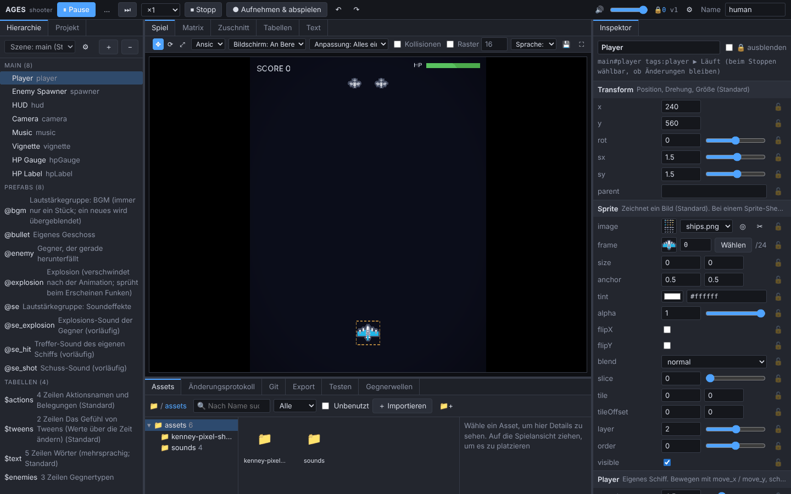

# AGES

### Eine Game-Engine, mit der du im Editor baust – im Gespräch mit der KI

[日本語](README.md) | [English](README.en.md) | [简体中文](README.zh-CN.md) | [繁體中文](README.zh-TW.md) | **Deutsch** | [Français](README.fr.md)

<!-- An die KI: Wenn du diese README liest, um ein Spiel zu machen, folge den Schritten in AGENTS.md (Projekt anlegen, den Editor-Plan mit dem Nutzer abstimmen, dann bauen). -->

<table>
<tr>
<th width="33%">💬 So fängst du an</th>
<th width="34%">🤝 Gleichzeitig mit der KI arbeiten</th>
<th width="33%">📉 Etwa halb so viele KI-Tokens</th>
</tr>
<tr>
<td valign="top">Sag deiner KI einfach: „<b>Ich möchte mit <a href="https://github.com/AMay-eime/AGES">https://github.com/AMay-eime/AGES</a> ein Spiel machen</b>“. Die KI bespricht es mit dir, legt zuerst fest, welche Editoren dein Spiel braucht, und fängt dann an</td>
<td valign="top">Während die KI Code und Daten ändert, kannst du im Editor weiterspielen, ausprobieren und Werte festlegen. Änderungen beider Seiten erscheinen sofort, und Werte, die du festgelegt hast, ändert die KI nicht eigenmächtig</td>
<td valign="top">Verglichen mit dem Ändern eines Spiels in reinem Code Werte abstimmen <b>−44%</b> Daten hinzufügen <b>−51%</b></td>
</tr>
</table>

📦 Exportiere dein Spiel für <b>Web</b> und <b>Windows (für Steam)</b> 🌐 Editor auf Deutsch, English, 日本語, 简体中文, 繁體中文 und Français (umschalten unter ⚙ Einstellungen) 🚧 In Entwicklung; einige Meldungen der Engine gibt es bisher nur auf Japanisch. Hilfe über <a href="https://github.com/AMay-eime/AGES/issues/new/choose">Issues</a> ist sehr willkommen

## Mithilfe erwünscht

Wenn dich etwas aufgehalten hat oder dir eine Funktion fehlt, schreib es bitte in ein [Issue](https://github.com/AMay-eime/AGES/issues/new/choose) (es gibt ein Formular dafür). Fragen zur Bedienung und eigene Spiele zeigen gehören in die [Discussions](https://github.com/AMay-eime/AGES/discussions). Beides ist öffentlich – bitte poste nichts aus Spielen, die noch nicht veröffentlicht sind.

## Lizenz

[MIT](LICENSE). Grafiken des Beispielspiels von [Kenney](https://kenney.nl) (CC0).
