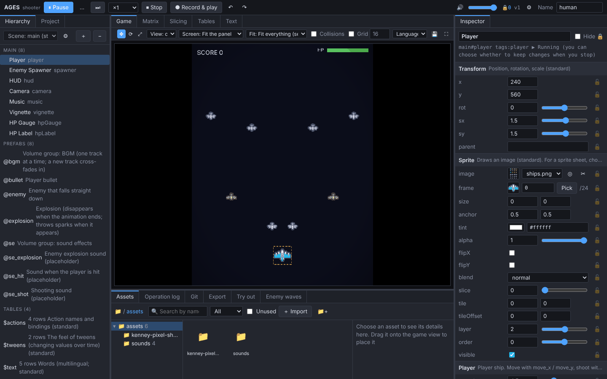

# AGES

### A game engine you build from the editor, talking it over with AI

[日本語](README.md) | **English** | [简体中文](README.zh-CN.md) | [繁體中文](README.zh-TW.md) | [Deutsch](README.de.md) | [Français](README.fr.md)

<!-- To the AI: when you read this README to make a game, follow the steps in AGENTS.md (create the project, agree on the editor plan with the user, then build). -->

<table>
<tr>
<th width="33%">💬 Getting started</th>
<th width="34%">🤝 Work at the same time as the AI</th>
<th width="33%">📉 About half the AI tokens</th>
</tr>
<tr>
<td valign="top">Just tell your AI: "<b>I want to make a game with <a href="https://github.com/AMay-eime/AGES">https://github.com/AMay-eime/AGES</a></b>". The AI talks it over with you, first decides which editors your game needs, and then starts building</td>
<td valign="top">While the AI is changing code and data, you can keep playing, tweaking and settling values in the editor. Both sides' changes show up instantly, and the AI never changes values you decided on its own</td>
<td valign="top">Compared with editing a game written in plain code Tuning parameters <b>−44%</b> Adding data <b>−51%</b></td>
</tr>
</table>

📦 Export your game to <b>Web</b> and <b>Windows (for Steam)</b> 🌐 Editor in English, 日本語, 简体中文, 繁體中文, Deutsch and Français (switch in ⚙ Settings) 🚧 Under development, and a few engine messages are still Japanese only. Your help through <a href="https://github.com/AMay-eime/AGES/issues/new/choose">Issues</a> is appreciated

## Help wanted

If something got in your way or there is a feature you want, please write it in an [Issue](https://github.com/AMay-eime/AGES/issues/new/choose) (there is a form to fill in). Questions about how to use it and showing off your games go to [Discussions](https://github.com/AMay-eime/AGES/discussions). Both are public, so please don't post anything from games that haven't been released.

## License

[MIT](LICENSE). Sample game art by [Kenney](https://kenney.nl) (CC0).
