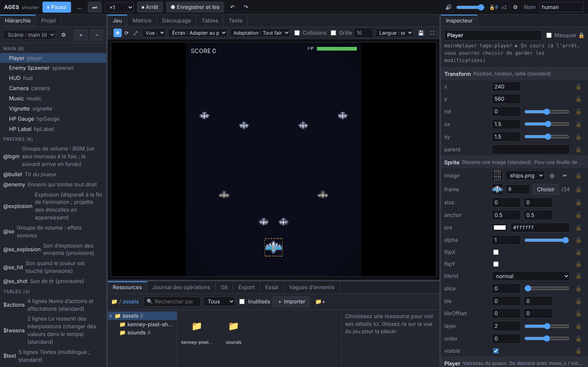

# AGES

### Un moteur de jeu où l’on construit depuis l’éditeur, en discutant avec l’IA

[日本語](README.md) | [English](README.en.md) | [简体中文](README.zh-CN.md) | [繁體中文](README.zh-TW.md) | [Deutsch](README.de.md) | **Français**

<!-- À l’IA : si tu lis ce README pour créer un jeu, suis les étapes d’AGENTS.md (créer le projet, convenir du plan des éditeurs avec l’utilisateur, puis construire). -->

<table>
<tr>
<th width="33%">💬 Pour commencer</th>
<th width="34%">🤝 Travailler en même temps que l’IA</th>
<th width="33%">📉 Environ moitié moins de tokens</th>
</tr>
<tr>
<td valign="top">Dites simplement à votre IA : « <b>Je veux créer un jeu avec <a href="https://github.com/AMay-eime/AGES">https://github.com/AMay-eime/AGES</a></b> ». L’IA en discute avec vous, décide d’abord des éditeurs dont votre jeu a besoin, puis commence à construire</td>
<td valign="top">Pendant que l’IA modifie le code et les données, vous pouvez continuer à jouer, essayer et fixer des valeurs dans l’éditeur. Les changements des deux côtés apparaissent aussitôt, et l’IA ne modifie jamais d’elle-même les valeurs que vous avez fixées</td>
<td valign="top">Par rapport à la modification d’un jeu écrit en code brut Réglage des valeurs <b>−44%</b> Ajout de données <b>−51%</b></td>
</tr>
</table>

📦 Exportez votre jeu pour le <b>Web</b> et <b>Windows (pour Steam)</b> 🌐 Éditeur en français, English, 日本語, 简体中文, 繁體中文 et Deutsch (à changer dans ⚙ Réglages) 🚧 En cours de développement ; quelques messages du moteur ne sont encore qu’en japonais. Votre aide via les <a href="https://github.com/AMay-eime/AGES/issues/new/choose">Issues</a> est la bienvenue

## Votre aide est la bienvenue

Si quelque chose vous a bloqué ou s’il vous manque une fonction, écrivez-le dans une [Issue](https://github.com/AMay-eime/AGES/issues/new/choose) (un formulaire est prévu). Les questions d’utilisation et la présentation de vos jeux vont dans les [Discussions](https://github.com/AMay-eime/AGES/discussions). Les deux sont publics : n’y mettez rien qui vienne d’un jeu pas encore publié.

## Licence

[MIT](LICENSE). Graphismes du jeu d’exemple par [Kenney](https://kenney.nl) (CC0).
