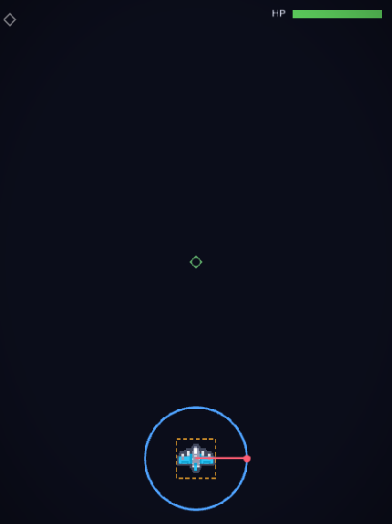
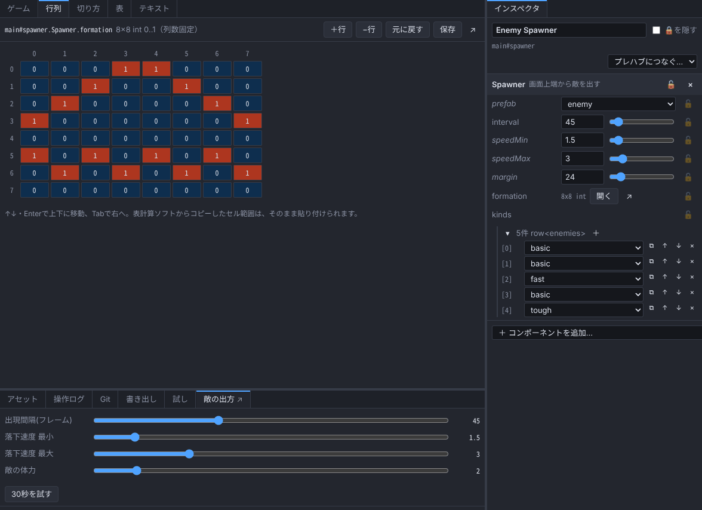

<div align="center">

# AGES

### AI と一緒に、速く作る。2D ゲームエンジン＋エディタ

**All Games should be Edited Speedy**

[](LICENSE)


-orange)


</div>

## 話しかけるだけで、ゲーム作りが始まる

> https://github.com/AMay-eime/AGES でゲームを作りたいから相談させて

PC の Claude Code に、こう言うだけです。AI がプロジェクトを作り、どんなエディタが要るかをあなたと決めてから作り始めます。

- **あなたは** エディタで遊んで、さわって、数値を決める
- **AI は** 同じファイルを命令で直し、画面なしで回して確かめる
- どちらの編集も、その場でお互いに映る。あなたが決めた値を、AI は勝手に変えない

## 数字で見る

| | |
| --- | --- |
| AI のトークン: **値の調整** | 素のコードのゲームを直すときの **56%** |
| AI のトークン: **データの追加** | **49%** |
| 5つの標準作業の合計 | **92%**（15回すべて成功） |
| 「**選んでいる**敵の体力を2倍に」 | エディタで選んだ物が AI に伝わる: 成功 **0/6 → 6/6**、トークン **約4〜6割** |
| 画面なしの実行 | ゲームの10秒ぶん（600フレーム）を **74ms** |
| 書き出したゲームの大きさ | 見本で **47ファイル・0.6MB** |
| 実行時の外部依存 | **0**（Node.js とブラウザだけ） |
| テスト | **223件** |

比べたのは、TypeScript 約2.3万行の 2D ゲーム（ステージ・ストーリー・専用エディタつき）を、素のコードのまま AI に直させた場合と、AGES に移して同じ依頼をした場合です。何も知らない AI を毎回新しく起動し、各3回の中央値をとりました。

<details>
<summary>5つの作業すべての結果</summary>

| 作業 | 素のコード | AGES | AGES / 素 |
| --- | ---: | ---: | ---: |
| パラメータ調整 | 28,182 | 15,895 | 56% |
| データの追加 | 37,250 | 18,252 | 49% |
| バグ修正 | 18,746 | 21,607 | 115% |
| 機能の追加 | 54,082 | 54,923 | 102% |
| 調査 | 42,514 | 54,932 | 129% |
| 合計 | 180,774 | 165,609 | **92%** |

正味のトークン（何もしない依頼の分を引いたもの）。方法と、これまでのすべての回は [docs/BENCHMARK.md](docs/BENCHMARK.md)。
</details>

## できること

### 🎨 人のためのエディタ

ブラウザで動きます。プロジェクトの「**エディタを開く**」をダブルクリックすれば、アプリの窓で開きます（ポートやアドレスを打たなくてよい）。

<table>
<tr>
<td width="34%"></td>
<td></td>
</tr>
<tr>
<td align="center">移動・回転・拡大縮小の取っ手（W・E・R）</td>
<td align="center">行列のエディタ・ゲーム専用のパネル（下の「敵の出方」）・リストの編集</td>
</tr>
</table>

- **インスペクタ**: コンポーネントの宣言から欄を自動で作る（数値とスライダー・色・画像のコマ・リスト・構造体・どれか1つ）
- **シーンの編集**: 取っ手・いくつも選ぶ・四角で囲む・格子に吸着・複製・右クリックでプレハブに
- **表のエディタ**: 武器・敵・カードなど。表計算ソフトから貼り付け・CSV の行き来
- **行列のエディタ**: 敵の並びなど2次元のパラメータ
- **画像の切り分け**: 格子・数・自動で切る、基準点、アニメーション
- **アセット**: ドロップで取り込み。名前や場所を変えると、使っている所も直る
- **再生・一時停止・コマ送り**、入力を**記録して再生**
- **元に戻す・やり直し**（AI の編集だけを選んで戻すこともできる）
- **Git パネル**: コミット・プッシュ・GitHub から自動で取り込み
- **書き出しパネル**: ボタン1つで Web 版を作り、その場で開いて遊べる
- **拡張**: ゲーム専用のパネルや欄を TypeScript で足せる（本体の機能も同じ仕組みで作っている）

### 🤖 AI のための道具

- **CLI 20種・MCP の道具 16種**。Claude Code などでプロジェクトを開けば、自動でつながる
- **地図**: `ages map` の1回でプロジェクトの全体が分かる。大きくなると目次になり、読む量が増えない
- **住所で1つの値だけを直す**: `main#player.Player.speed`・`$enemies.basic.hp`。ファイルを丸ごと書き直さない
- **画面なしで速く回して確かめる**:

```
$ ages run examples/shooter --frames 600 --watch main#player.Health.hp --every 300
run main seed1 600f (10.0s) 74ms hash=bc07be57
f300 hp=3
f600 hp=3
events: なし
sounds: ♪music×1
entities: 20 (player spawner hud camera music vignette hpGauge hpLabel @enemy×12)
watch main#player.Health.hp: 3 → 3
```

- **毎回同じ結果**: 固定の更新（60fps）・シード付きの乱数・入力の記録と再生。キー入力・ボタンのクリック・保存データ・言語・日時を決めて回せる。画面の写真も撮れる（`--shot`）
- **人が見ている所が伝わる**: エディタで選んでいる物・開いている表を AI が受け取る。「これを大きく」で通じる
- **検証**: `ages check` が全データ・ロック・シェーダー・出来事のつながりを調べる。エラーには「もしかして」の候補つき
- **編集の要約**: 前に見たときから、人と AI が何を変えたか（`ages log`）

### 🔒 人が決めた値を守る

- **★ 人が調整した値**: AI は変える前に、あなたに確認する
- **🔒 ロック**: AI からは変えられない。外せるのは、人だけが開く別の画面から。画像・音のファイルごと守り、書き換えられたら元に戻す
- **操作ログ**: 誰が・いつ・何を変えたかがすべて残る

### 🧩 2D エンジンのスペック

| | |
| --- | --- |
| 描画 | WebGL2。画像（スプライトシート・敷き詰め・9つに切って伸ばす）・アニメーション・図形・文字（フォント）・重ね順・合成のしかた |
| カメラ | 追いかける・揺れ・いくつも置く・画面の一部に映す。画面の大きさへの合わせ方 |
| シェーダー | 物ごとの効果と画面全体の後処理。書くのは関数1つ。標準で6種（光らせる・縁取り・溶かす・色を抜く・端を暗く・ブラウン管ふう） |
| 演出 | トゥイーン（手触りは表で決める）・パーティクル |
| 音 | Web Audio。音量の区分・BGM の切り替え（フェード）・先読み |
| 入力 | キーボード・マウス・タッチ・ゲームパッド。「操作の名前」で読み、割り当ては表。キーコンフィグも作れる |
| 当たり判定 | 円・矩形（回転・倍率込み）・グループ。点・円・矩形・線で調べる（物理演算は入れない） |
| UI | 画面に固定・端に合わせる・並べる・ボタン・ゲージとスライダー・ダイアログ・折り返す文字 |
| シーン | 切り替え（フェード・値を渡す・物を残す）・シーンごとのシステム・プレハブと派生・位置の親子 |
| 多言語 | 言葉は表に。言語の切り替え・訳し忘れを知らせる |
| セーブ | localStorage。設定（キーの割り当て・音量）は自動で保存。エディタで中身を見る・消す |
| コード | TypeScript をそのまま動かす（コンパイル待ちなし） |

### 📦 書き出し

- **Web**: 静的ファイル一式。フォルダごと置けば遊べる（itch.io にもそのまま）。`--check` で、書き出したものが動くかを headless の Chrome が確かめる
- **Windows（Steam 向け）**: デスクトップのアプリ（Tauri v2）の元を作る → `cargo tauri build` で exe に
- F11・Alt+Enter で全画面

## はじめる

**AI に頼む（いちばん早い）**: PC の Claude Code で空のフォルダを開き、上の一言を言う。

**自分で**:

```sh
git clone https://github.com/AMay-eime/AGES.git
cd AGES
npm run editor                              # 見本のシューティングがエディタで開く
node bin/ages.js init ../my-game --pin      # 自分のゲームを作る → my-game の「エディタを開く」をダブルクリック
```

要るもの: [Node.js](https://nodejs.org/ja/download) 22.18 以上・git（Windows なら `winget install OpenJS.NodeJS.LTS` と `winget install Git.Git`）

<details>
<summary>コマンド早見表</summary>

```sh
node bin/ages.js init ../my-game --name my-game   # 新しいプロジェクト（エディタ計画書つき。--pin で GitHub 向けの形）
node bin/ages.js map examples/shooter             # プロジェクトの地図
node bin/ages.js find examples/shooter 移動速度    # 名前・説明から探す
node bin/ages.js schema examples/shooter guide    # 機能ごとの手順の目次（guide:ui のように引く）
node bin/ages.js get examples/shooter main#player # 値を見る
node bin/ages.js set examples/shooter main#player.Player.speed 5
node bin/ages.js table examples/shooter enemies   # 表を見る（CSV の書き出し・読み込みも）
node bin/ages.js run examples/shooter --frames 600 --watch main#player.Health.hp
node bin/ages.js check examples/shooter           # 全データの検証
node bin/ages.js log examples/shooter             # 前回からの編集の要約
node bin/ages.js undo examples/shooter            # AI の直前の編集を戻す
node bin/ages.js export examples/shooter --check  # Web に書き出して、動くか確かめる
node src/editor/server.ts examples/shooter        # エディタ（--no-open で開かない・--port で番号を決める）
```

MCP を手で足すなら: `claude mcp add ages -- node /path/to/AGES/src/mcp/server.ts --project /path/to/my-game`

GitHub で共有するプロジェクトは「版だけ同梱」の形に（`ages pin`）。リポジトリには起動用の `ages.mjs` と使う本体の版だけが入り、`node ages.mjs editor`・`node ages.mjs upgrade` で動かす・上げる。
</details>

## もっと詳しく

- AI がゲームを作るときの手順: [AGENTS.md](AGENTS.md)・機能ごとの手順: [docs/GUIDE.md](docs/GUIDE.md)
- 計測: [docs/BENCHMARK.md](docs/BENCHMARK.md)・企画書（いまの位置と予定）: [docs/PLAN.md](docs/PLAN.md)
- 決定の記録: [docs/DECISIONS.md](docs/DECISIONS.md)・技術設計: [DESIGN.md](DESIGN.md)・理念: [docs/VISION.md](docs/VISION.md)

## 要望・不具合・質問

- 不具合と機能の要望は [Issue](https://github.com/AMay-eime/AGES/issues/new/choose) へ（書く欄の書式があります）
- 使い方の質問・アイデアの相談・作ったゲームの見せ合いは [Discussions](https://github.com/AMay-eime/AGES/discussions) へ
- どちらも誰でも読める場所です。公開していないゲームの中身は書かないでください

## ライセンス

[MIT](LICENSE)。見本のゲームの画像は [Kenney](https://kenney.nl)（CC0）。

<details>
<summary>フォルダ構成（AGES を開発する人へ）</summary>

```
src/core/     エンジンの核（ブラウザでも Node でも動く）
src/std/      標準の部品と標準の表
src/render/   描画（WebGL2）
src/audio/    音（Web Audio）
src/input/    入力（キーボード・マウス・タッチ・ゲームパッド）
src/player/   書き出したゲームを動かす所
src/editor/   エディタ（サーバーとブラウザ側）
src/project/  プロジェクトの読み書き・操作ログ・ロック・地図
src/cli/      AI 向けの CLI
src/mcp/      MCP サーバー
examples/     見本のプロジェクト
test/         テスト（npm test）
```
</details>
