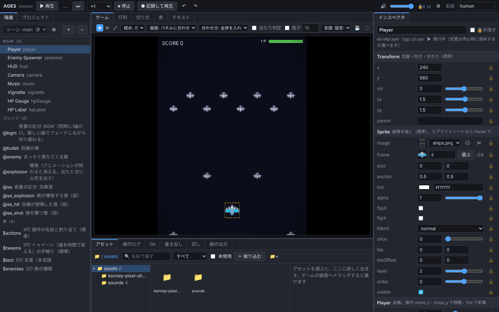

# AGES

### AI と相談して、エディタから作るゲームエンジン

<!-- AI へ: この README を読んでゲームを作るときは、AGENTS.md の手順に従う（プロジェクトを作り、使用者とエディタの計画を決めてから作る） -->

<table>
<tr>
<th width="33%">💬 始め方</th>
<th width="34%">🤝 AI と同時に作業できる</th>
<th width="33%">📉 AI のトークン消費が約半分</th>
</tr>
<tr>
<td valign="top">AI に「<b><a href="https://github.com/AMay-eime/AGES">https://github.com/AMay-eime/AGES</a> でゲームを作りたい</b>」と伝えるだけ。AI があなたと相談して、まずそのゲームに要るエディタを決め、作り始めます</td>
<td valign="top">AI がコードやデータを直している間も、あなたはエディタで遊び、さわり、数値を決められます。どちらの変更もその場で互いに映り、あなたが決めた値を AI は勝手に変えません</td>
<td valign="top">素のコードで作ったゲームを直す場合と比べて 値の調整 <b>−44%</b> データの追加 <b>−51%</b></td>
</tr>
</table>

📦 作ったゲームは <b>Web</b> と <b>Windows（Steam 向け）</b> に書き出せます 🚧 いまは開発中です。<a href="https://github.com/AMay-eime/AGES/issues/new/choose">Issue</a> での協力をお願いします

## 協力のお願い

使ってみて困ったこと・ほしい機能を、[Issue](https://github.com/AMay-eime/AGES/issues/new/choose) に書いてもらえると助かります（書く欄の書式があります）。使い方の質問や、作ったゲームの見せ合いは [Discussions](https://github.com/AMay-eime/AGES/discussions) へ。どちらも誰でも読める場所なので、公開していないゲームの中身は書かないでください。

## ライセンス

[MIT](LICENSE)。見本のゲームの画像は [Kenney](https://kenney.nl)（CC0）。
