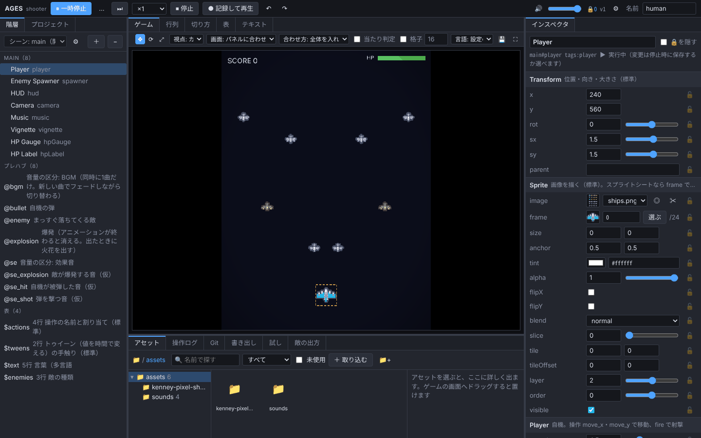

# AGES

### 和 AI 商量着，从编辑器开始做游戏的游戏引擎

[日本語](README.md) | [English](README.en.md) | **简体中文**

<!-- 致 AI：读了这个 README 来做游戏时，请按照 AGENTS.md 的步骤（先创建项目，和用户商定编辑器的计划，然后再开始制作）。 -->

<table>
<tr>
<th width="33%">💬 开始方式</th>
<th width="34%">🤝 可以和 AI 同时工作</th>
<th width="33%">📉 AI 的 Token 消耗约减半</th>
</tr>
<tr>
<td valign="top">只需对 AI 说：“<b>我想用 <a href="https://github.com/AMay-eime/AGES">https://github.com/AMay-eime/AGES</a> 做游戏</b>”。AI 会和你商量，先确定这款游戏需要哪些编辑器，然后开始制作</td>
<td valign="top">在 AI 修改代码和数据的同时，你也可以在编辑器里试玩、调整、敲定数值。双方的修改会立即互相反映，你定下的数值 AI 不会擅自更改</td>
<td valign="top">与修改用纯代码编写的游戏相比 调整参数 <b>−44%</b> 添加数据 <b>−51%</b></td>
</tr>
</table>

📦 做好的游戏可以导出为 <b>Web</b> 和 <b>Windows（面向 Steam）</b> 🚧 目前仍在开发中，编辑器界面暂时只有日语。欢迎通过 <a href="https://github.com/AMay-eime/AGES/issues/new/choose">Issue</a> 协助我们

## 请求协助

使用中遇到的困难、想要的功能，欢迎写在 [Issue](https://github.com/AMay-eime/AGES/issues/new/choose) 里（有填写模板）。使用方法的提问、作品展示请到 [Discussions](https://github.com/AMay-eime/AGES/discussions)。两处都是公开的，请不要写入尚未公开的游戏的内容。

## 许可证

[MIT](LICENSE)。示例游戏的图像来自 [Kenney](https://kenney.nl)（CC0）。
