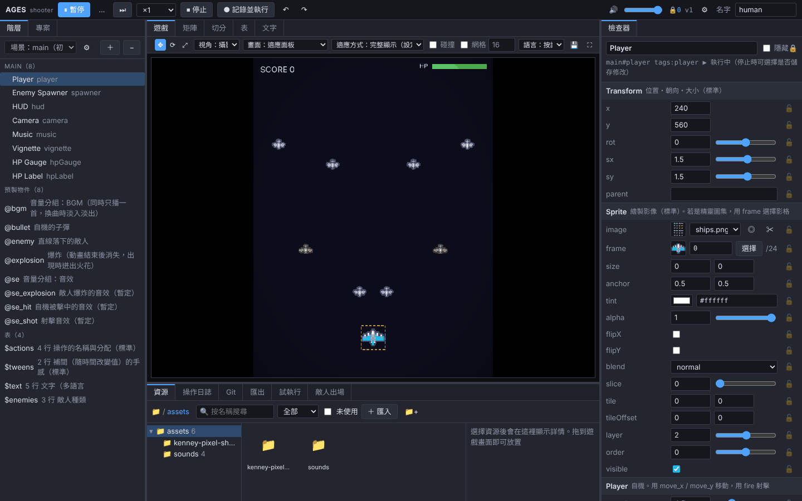

# AGES

### 和 AI 商量著，從編輯器開始做遊戲的遊戲引擎

[日本語](README.md) | [English](README.en.md) | [简体中文](README.zh-CN.md) | **繁體中文** | [Deutsch](README.de.md) | [Français](README.fr.md)

<!-- 致 AI：讀了這份 README 來做遊戲時，請依照 AGENTS.md 的步驟（先建立專案，和使用者商定編輯器的計畫，然後再開始製作）。 -->

<table>
<tr>
<th width="33%">💬 開始方式</th>
<th width="34%">🤝 可以和 AI 同時工作</th>
<th width="33%">📉 AI 的 Token 消耗約減半</th>
</tr>
<tr>
<td valign="top">只要對 AI 說：「<b>我想用 <a href="https://github.com/AMay-eime/AGES">https://github.com/AMay-eime/AGES</a> 做遊戲</b>」。AI 會和你商量，先決定這款遊戲需要哪些編輯器，然後開始製作</td>
<td valign="top">在 AI 修改程式碼和資料的同時，你也可以在編輯器裡試玩、調整、敲定數值。雙方的修改會立即互相反映，你定下的數值 AI 不會擅自更改</td>
<td valign="top">與修改用純程式碼撰寫的遊戲相比 調整參數 <b>−44%</b> 新增資料 <b>−51%</b></td>
</tr>
</table>

📦 做好的遊戲可以匯出為 <b>Web</b> 和 <b>Windows（面向 Steam）</b> 🌐 編輯器支援繁體中文、简体中文、日本語、English、Deutsch、Français（在 ⚙ 設定中切換） 🚧 目前仍在開發中，部分引擎提示暫時只有日文。歡迎透過 <a href="https://github.com/AMay-eime/AGES/issues/new/choose">Issue</a> 協助我們

## 請求協助

使用中遇到的困難、想要的功能，歡迎寫在 [Issue](https://github.com/AMay-eime/AGES/issues/new/choose) 裡（有填寫範本）。使用方法的提問、作品展示請到 [Discussions](https://github.com/AMay-eime/AGES/discussions)。兩處都是公開的，請不要寫入尚未公開的遊戲內容。

## 授權

[MIT](LICENSE)。範例遊戲的圖像來自 [Kenney](https://kenney.nl)（CC0）。
